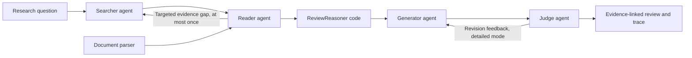

# Paperazzi

**A multi-agent AI assistant for evidence-linked scientific literature reviews.**

Paperazzi searches research databases, inspects available paper text, synthesizes findings, and evaluates how well review statements are supported by their citations. Its purpose is to explore **agentic AI workflows** with transparent tool use, structured handoffs, and inspectable evidence—not to replace expert scientific review.

> **Status:** Working local multi-agent prototype. Citation support is assessed by LLM rubrics; independent scientific verification is **not connected**.

## How it works



- **Searcher:** Searches and inspects literature records, refining queries when needed.
- **Reader:** Inspects available passages, extracts claims, records exclusions, and can request a targeted follow-up search.
- **ReviewReasoner:** Deterministic code organizes Reader-assigned claim relationships; it does **not** independently establish scientific truth.
- **Generator:** Produces a review grounded in prepared claims and citations.
- **Judge:** Uses two LLM rubrics to assess statement support and snippet relevance, returning feedback for a bounded revision.

The **document parser** and **coordinator** are ordinary code, not additional LLM agents.

## Features

- Literature retrieval from **PubMed, arXiv, Europe PMC, and Semantic Scholar**.
- Available full-text XML/PDF parsing with explicit abstract-only fallback.
- Source-linked claims, passages, locations, and inspectable agent traces.
- Evidence-gap follow-up search (up to one additional search phase).
- Citation-support and snippet-relevance assessments with visible ratings.
- Brief and detailed review modes; detailed mode supports one feedback revision.
- Local saved briefs and Markdown export.
- Explicit incomplete, unsupported, and unresolved-evidence states.

## Quick start

**Requirements:** Node.js 22+, Python 3.11+, and an OpenRouter API key for agent runs.

```bash
python3 -m venv .venv
.venv/bin/python -m pip install -r agents/requirements.txt
npm run dev:agent
```

Enter the OpenRouter key at the launcher's hidden terminal prompt (or set `OPENROUTER_API_KEY` in the environment). Open:

**http://127.0.0.1:4173/?mode=multiagent**

Select **Multi-agent review · four specialists**. The multi-agent workflow runs **locally** and is not part of the hosted Worker deployment.

For the baseline interface without a model key:

```bash
npm run dev
```

This mode can return clearly labeled source excerpts instead of a model-generated synthesis.

## Explore the results

The interface includes an **Evidence & trace** view with cited passages, statement-level support and relevance assessments, and recorded agent actions. A `complete` status means the configured citation rubrics passed; it does **not** establish scientific validity.

<!-- Add a real screenshot or GIF here after capturing a successful local run. -->

## Run tests

```bash
npm test
npm run test:agents
```

The tests use fixtures and scripted model behavior. They do not establish live-model scientific accuracy. The Python test command requires the virtual environment created above.

## Documentation

- [Architecture and agent workflow](docs/architecture.md)
- [Installation and configuration](docs/getting-started.md)
- [Citation evaluation](docs/evaluation.md)
- [API reference](docs/api.md)
- [Limitations and validation gaps](docs/limitations.md)
- [Learning milestones and next steps](docs/development.md)

## Scope and limitations

Paperazzi is a **research and Agentic AI learning prototype**. It is not an autonomous scientific fact-checker. The Reader's semantic judgments can be wrong; the Judge uses LLM rubrics; source extraction is bounded and does not fully reconstruct tables, figures, or supplements. The local multi-agent run initially selects up to four papers and can add at most two more. See [limitations](docs/limitations.md).
